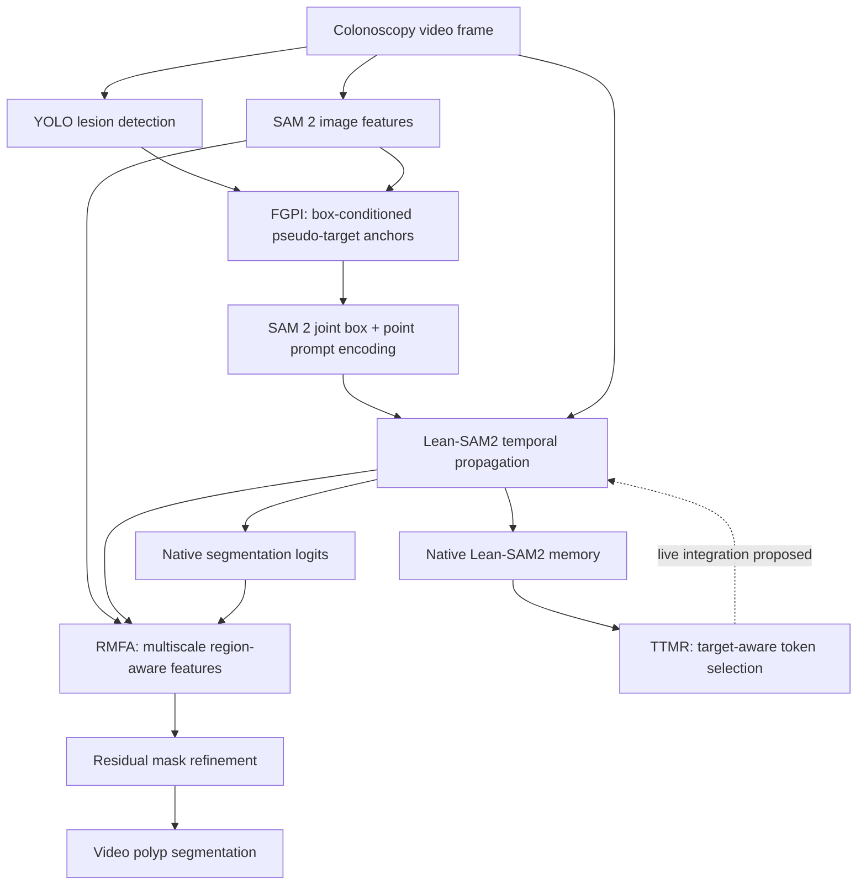

# AdeSEG

**Automatic video polyp segmentation with feature-guided prompting, region-aware refinement, and target-aware temporal memory.**

AdeSEG studies a modular extension of SAM 2 and Lean-SAM2 for colonoscopy video segmentation. The proposed architecture is organized into **three scientific contributions**:

| Contribution | Problem addressed | Mechanism |
|---|---|---|
| **FGPI — Feature-Guided Prompt Initialization** | Ambiguous initial target localization | YOLO box + early-feature pseudo-target anchors + positive/negative point prompts |
| **RMFA — Region-Aware Multistage Feature Aggregation** | Weak foreground/background and boundary discrimination | Early/deep feature fusion, region-aware channel attention, residual mask-logit refinement |
| **TTMR — Target-Aware Temporal Memory Refinement** | Redundant or drifting historical information | Target-conditioned token scoring, diversity penalties, temporal retention under fixed memory budget |

## Architecture



The diagram specifies the **proposed unified framework**. The existing FGPI video runner uses MedSAM2 Hiera-T, while RMFA and the Lean memory experiments use SAM2.1 Hiera-B+. TTMR currently has an offline reference selector. Those boundaries are explicit in the [methodology](docs/methodology/OVERVIEW.md).

## Repository organization

```text
AdeSEG/
├── adeseg/
│   ├── modules/           # Canonical FGPI, RMFA, TTMR research modules
│   │   ├── fgpi/          # pseudo-target anchors + joint prompts
│   │   ├── rmfa.py        # source-compatible learned refinement API
│   │   └── ttmr/          # causal temporal selection policy
│   ├── prompts/           # backward-compatible import aliases only
│   ├── adapters/          # spatial refinement adapters
│   ├── memory/            # spatial RoPE, Lean anchors + TTMR compat alias
│   ├── backbones/         # Lean-SAM2 / MedSAM2 model interfaces
│   ├── inference/         # mask and memory routing integrations
│   ├── losses/            # supervised and preservation objectives
│   ├── evaluation/        # metric exports
│   └── research/          # dataset and experiment contracts
├── docs/
│   ├── methodology/       # architectural formulation and contributions
│   └── experiments/       # protocol and ablation design
├── datasets/              # frame/annotation manifest loading
├── evaluation/            # evaluation implementations
├── training/              # training and checkpoint control
├── scripts/               # executable experiment commands
├── modeling/              # original source-bound model implementations
├── experiments/           # reference model utilities and study tracks
├── tests/                 # CPU and integration regressions
└── external/              # pinned author implementations
```

The implementation files under `modeling/` are intentionally not renamed or duplicated because existing checkpoints, imports, and experiment receipts depend on their original interfaces.

## Start here

[**Framework overview**](docs/methodology/OVERVIEW.md) ·
[FGPI](docs/methodology/FGPI.md) ·
[RMFA](docs/methodology/RMFA.md) ·
[TTMR](docs/methodology/TTMR.md) ·
[Experiment strategy](docs/experiments/PLAN.md)

```bash
git clone --recurse-submodules https://github.com/aCoderChild/AdeSEG.git
cd AdeSEG
python -m pip install -r requirements.txt

python -m pytest -q tests
python -m scripts.export_yolo_detections --help
python -m scripts.infer_fgpi_video --help
python -m scripts.train_lean --help
```

[CLI and reproduction guide](scripts/README.md) · [Validation and infrastructure](docs/VERIFICATION.md)

## Research and history

The primary research task is video **polyp** segmentation. PolypGen colonoscopy data does not alone validate adenoid segmentation. Historical baseline results and early methodology drafts are preserved separately on the [backup branch](https://github.com/aCoderChild/AdeSEG/tree/backup/experiment-full-20261118/reports). Current methodology descriptions are separated from numerical results.
