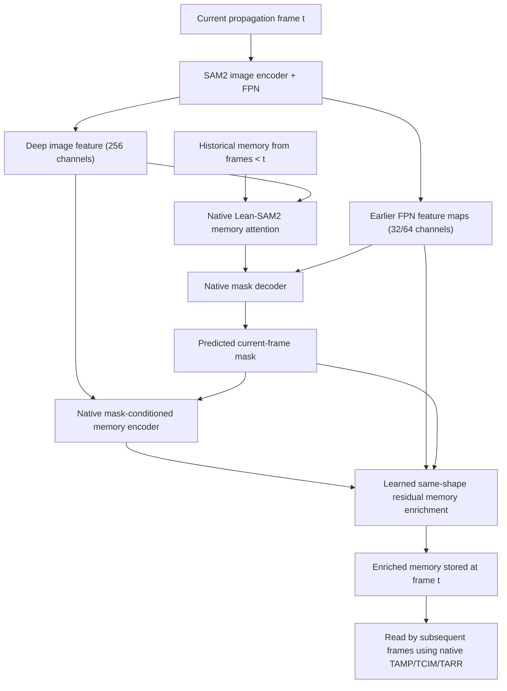
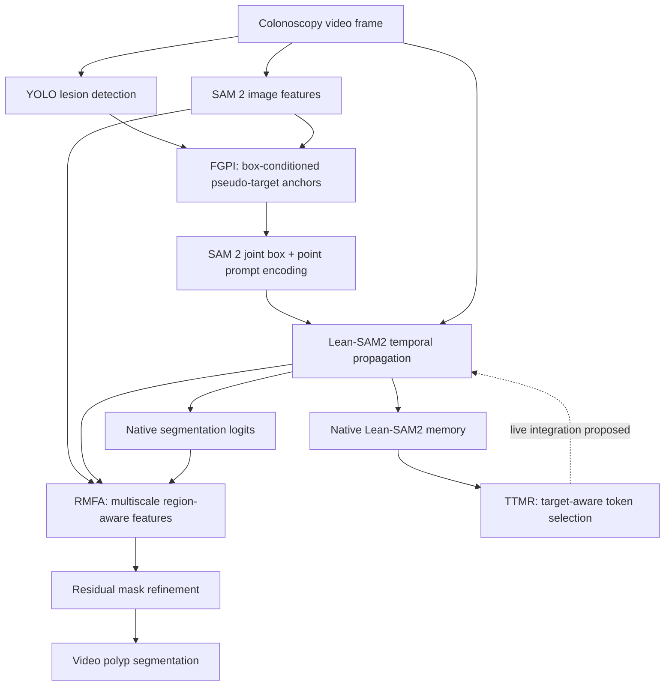

# AdeSEG

**Research-stage automatic video polyp segmentation using SAM 2 / Lean-SAM2.**

AdeSEG contains two distinct methodological tracks. The **current multiscale
temporal-memory experiment** enriches the final mask-conditioned SAM2 memory
representation using two earlier image/FPN feature levels, preserving the
native memory-grid shape and retaining native Lean-SAM2 TAMP/TCIM/TARR.
The current experiment starts from *frozen automatic masks* and is **not yet
an integrated YOLO/FGPI-to-Lean-SAM2 pipeline**. Segmentation improvements
and clinical adenoid applicability have not been established.

Read the **[current methodology](docs/methodology/OVERVIEW.md)** and
**[runnable memory experiment](docs/experiments/LEAN_MEMORY_FUSION_PREFLIGHT.md)**
before interpreting results or adapting existing experiments.

## Active Lean-SAM2 memory-write pipeline

This is the **implemented memory-fusion experiment**; the detector/FGPI
initialization step remains **external** and supplies a frozen automatic
mask prompt.



The adapter changes **future historical memory**, not the already
predicted current-frame mask. The initial conditioning frame is native
by default. Its output memory channels and positional encoding are
unchanged, although subsequent attention and native retention
decisions can change. See [the method](docs/methodology/OVERVIEW.md).

### Historical FGPI / RMFA / TTMR proposal

The following independently developed modules belong to the older proposed
architecture. They are **not all active together** in the multiscale
memory-enrichment runner:

| Contribution | Problem addressed | Mechanism |
|---|---|---|
| **FGPI — Feature-Guided Prompt Initialization** | Ambiguous initial target localization | YOLO box + early-feature pseudo-target anchors + positive/negative point prompts |
| **RMFA — Region-Aware Multistage Feature Aggregation** | Weak foreground/background and boundary discrimination | Early/deep feature fusion, region-aware channel attention, residual mask-logit refinement |
| **TTMR — Target-Aware Temporal Memory Refinement** | Redundant or drifting historical information | Target-conditioned token scoring, diversity penalties, temporal retention under fixed memory budget |

## Historical proposed architecture (not an end-to-end verified pipeline)



**The diagram above is an archived research proposal, not the current
executable pipeline.** FGPI's video runner uses MedSAM2 Hiera-T, while
memory-fusion inference uses Lean-SAM2 Hiera-B+. RMFA is an output-logit
refiner and TTMR is an additional proposed selector; neither is silently
enabled in the active Lean memory-fusion experiment. See the
[current method and validation status](docs/methodology/OVERVIEW.md).

## Repository organization

```text
AdeSEG/
├── adeseg/
│   ├── modules/           # Canonical FGPI, RMFA, TTMR research modules
│   │   ├── fgpi/          # pseudo-target anchors + joint prompts
│   │   ├── rmfa.py        # source-compatible learned refinement API
│   │   └── ttmr/          # causal temporal selection policy
│   ├── prompts/           # backward-compatible import aliases only
│   ├── adapters/          # spatial refinement adapters
│   ├── memory/            # spatial RoPE, Lean anchors + TTMR compat alias
│   ├── backbones/         # Lean-SAM2 / MedSAM2 model interfaces
│   ├── inference/         # mask and memory routing integrations
│   ├── losses/            # supervised and preservation objectives
│   ├── evaluation/        # metric exports
│   └── research/          # dataset and experiment contracts
├── docs/
│   ├── methodology/       # architectural formulation and contributions
│   └── experiments/       # protocol and ablation design
├── datasets/              # frame/annotation manifest loading
├── evaluation/            # evaluation implementations
├── training/              # training and checkpoint control
├── scripts/               # executable experiment commands
├── modeling/              # original source-bound model implementations
├── experiments/           # reference model utilities and study tracks
├── tests/                 # CPU and integration regressions
└── external/              # pinned author implementations
```

The implementation files under `modeling/` are intentionally not renamed or duplicated because existing checkpoints, imports, and experiment receipts depend on their original interfaces.

## Start here

[**Current architecture and scope**](docs/methodology/OVERVIEW.md) ·
[**Memory-fusion experiment commands**](docs/experiments/LEAN_MEMORY_FUSION_PREFLIGHT.md) ·
[FGPI](docs/methodology/FGPI.md) ·
[RMFA](docs/methodology/RMFA.md) ·
[TTMR](docs/methodology/TTMR.md) ·
[Experiment strategy](docs/experiments/PLAN.md)

```bash
git clone --recurse-submodules https://github.com/aCoderChild/AdeSEG.git
cd AdeSEG
python -m pip install -r requirements.txt

python -m pytest -q tests
python -m scripts.export_yolo_detections --help
python -m scripts.infer_fgpi_video --help
python -m scripts.train_lean --help
```

[CLI and reproduction guide](scripts/README.md) · [Validation and infrastructure](docs/VERIFICATION.md)

## Experimental multiscale memory enrichment (separate study track)

The repository also contains an experimental **early-FPN to mask-conditioned
temporal-memory adapter** for Lean-SAM2. It enriches memory on write, retains
native memory tensor geometry, and uses native TAMP pruning on later reads.
This is distinct from the original output-mask RMFA refiner and the offline
TTMR selection study; improvements have **not** been established.

For reproducible matched ablations, source provenance, and GPU/DEV preflight,
see [Lean memory-fusion experiment protocol](docs/experiments/LEAN_MEMORY_FUSION_PREFLIGHT.md)
and [the source-level mathematical audit](docs/methodology/LEAN_MEMORY_ENRICHMENT_AUDIT.md).

## Research and history

The primary research task is video **polyp** segmentation. PolypGen colonoscopy data does not alone validate adenoid segmentation. Historical baseline results and early methodology drafts are preserved separately on the [backup branch](https://github.com/aCoderChild/AdeSEG/tree/backup/experiment-full-20261118/reports). Current methodology descriptions are separated from numerical results.
