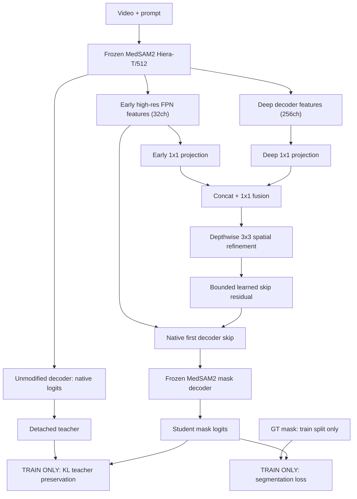
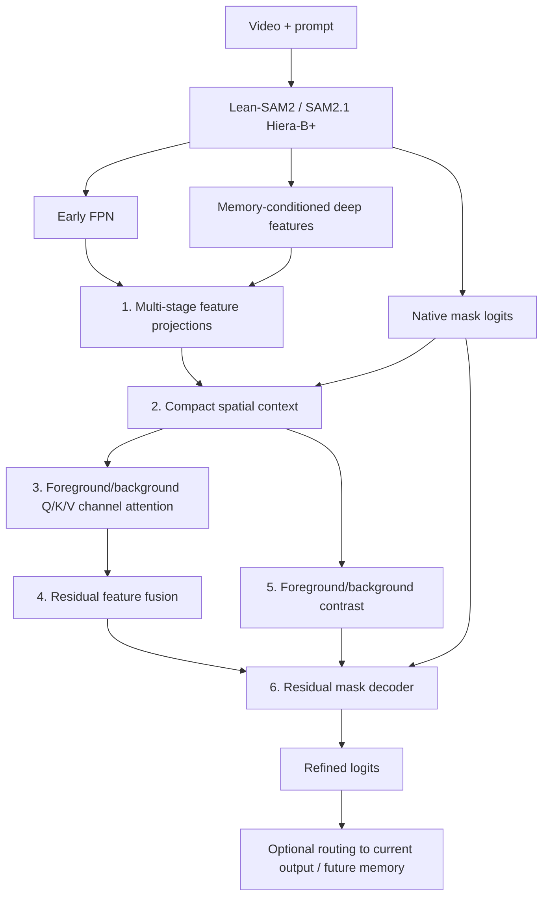

# AdeSEG architecture — what is new and what is reused

The repository contains **two experimental research directions**, not a
single network that simultaneously runs Lean-SAM2 and MedSAM2. Each has
its own backbone, modification, and training objective.

## Method A — MedSAM2 high-resolution skip refinement

**Added trainable component:** `adeseg.adapters.high_resolution_skip`.
Five conv layers project, fuse and refine early/deep features into a bounded
residual on the decoder's first high-resolution skip. The native pretrained
backbone and decoder weights stay frozen.

**Added training regularizer:** `adeseg.losses.teacher_kl`, penalizing
divergence from the frozen model's predictions on the *same* training sample.
Optionally combine with positive-region preservation and supervised mask loss.
**Teacher logits and ground truth are not inference inputs.** KL by itself is
standard knowledge distillation; the testable idea is whether coupling it to
high-resolution feature injection reduces degradation of correct masks.

**Critical limitation:** the historic high-resolution adapter's original
forward source is **missing**. The current five-layer reconstruction matches
one saved checkpoint's parameter tensor shapes, but assumed GELU/residual
operations have **not** been proven equivalent to that code. Four-sequence
historical pilots failed predeclared advancement gates. No 21-video success
or clinical benefit has been shown.

## Method B — Lean-SAM2 multi-stage feature aggregation

**Added trainable component:**
`adeseg.adapters.multiscale_channel_attention`. It projects early and deep
features to a shared representation, pools regional context from *predicted*
soft masks, uses Q/K channel correlations to mix V, and predicts a bounded-by-
training (not mathematically bounded) residual mask correction.

The six blocks are implemented in
`modeling/aggregation_blocks/` and
`modeling/structured_feature_aggregation.py` (retained at their original
paths for checkpoint compatibility). The structured module inherits
parameters and the source-bound loader of the original
`MultiscaleChannelValueRefinerV1`. It is a decomposition of that
architecture, **not a newly validated scoring method**.

**Controlled variables:** native Lean versus learned residual; with/without
channel mixing; foreground versus global channel correlations; output-only
versus future-memory routing; matched automatic prompt budget, frames,
checkpoint and masks. Multi-scale *memory-anchor weighting* is a separate
untrained ablation and should not be called feature aggregation.

**Critical limitation:** earlier pilots were mixed. The recorded
**0.742071** patient-macro Dice belongs to a different, indexed-RoPE
compatibility-corrected author Lean-SAM2 run **without** this adapter.

## Research claims and validation checklist

| Claim | Currently supported? |
|---|---|
| MedSAM2 and Lean-SAM2 pretrained weights are distinct | Yes — source records identify different checkpoint SHA256 |
| Learned medical adapter has five registered conv layers | Yes — checkpoint tensor schema recovered |
| Reconstructed adapter equals historical adapter forward | **No** — original source missing |
| Training-only teacher KL objective is implemented | Yes — no inference-time GT pathway in this loss |
| Six-stage Lean refiner shares checkpoint parameter names | Yes by class inheritance; numeric parity needs executable regression testing |
| Either adapter improves 21-sequence Dice | **No** |
| 0.742071 Dice is from a corrected author Lean baseline | Yes, saved 21-sequence exploratory record |
| Any method has demonstrated clinical adenoid generalization | **No** |

Before a thesis claim: execute unit and forward-parity tests, verify
pretrained and adapter weight hashes, seal independent patient/video groups,
rerun controlled 21-video paired inference (including empty-frame false
alarms) and evaluate on previously untouched external adenoid data.

**Source navigation:** [Medical implementation](../adeseg/adapters/high_resolution_skip.py),
[Lean implementation](../adeseg/adapters/multiscale_channel_attention.py),
[loss modules](../adeseg/losses/teacher_kl.py),
[historical checkpoint evidence](CHECKPOINT_PROVENANCE.md).
