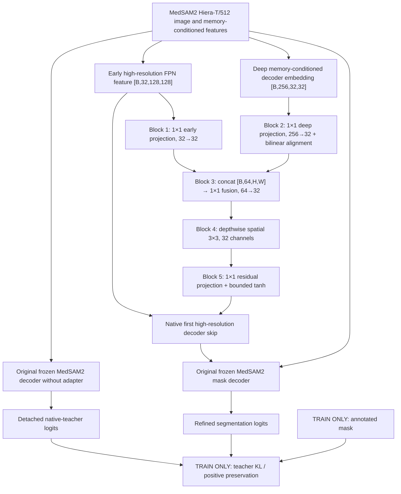

# Contribution 1 — MedSAM2 high-resolution refinement with native-teacher preservation

**Status:** an original, *reconstructed* research implementation from the saved
checkpoint's exact five-layer parameter geometry and the archived experiment
reports. It is **not** the exact historical forward source. Historical video
results cannot be reproduced or attributed to this refactor without an
independent numerical and source-hash audit.

## Block diagram



## Five layers recovered from a real saved adapter checkpoint

| Registered parameter | Weight shape | Computation |
|---|---|---|
| `early_proj` | `[32,32,1,1]` | Project early FPN channels |
| `deep_proj` | `[32,256,1,1]` | Project deep decoder channels |
| `fuse` | `[32,64,1,1]` | Fuse channel-concatenated scales |
| `spatial` | `[32,1,3,3]` | Depthwise local spatial refinement |
| `output` | `[32,32,1,1]` | Predict an additive high-resolution skip residual |

This geometry contains **12,736 parameters** including biases. It was verified
by directly loading the saved `highres_initial_clip_native_teacher_resume_v2`
checkpoint with full SHA-256
`96d48afe993826436f3b799223592c6e1829f6970f25ff9ca2bc2e00692a19fd`.
The exact original operations, activation order, residual multiplier, and
input preprocessing were **not** recoverable from those weights alone.

The new implementation chooses GELU after feature fusion and depthwise
convolution, then a configurable `maximum_delta * tanh(output)` correction.
These are **explicit reconstruction assumptions**, not claims about the
original source. At zero initialization, the output projection produces zero
and the native decoder skip is preserved exactly.

## Native-MedSAM2 integration

`modeling/medical_highres/integration.py` installs a scoped, reversible
`sam_mask_decoder.forward` pre-hook. The first element of
`high_res_features` receives the adapter correction; the second skip is
unchanged. Deep input is the memory-conditioned `image_embeddings` arriving
at the native decoder. The original model, memory bank, prompts, decoder
weights, and object-presence branch are not explicitly replaced.

The hook does **not** run if the native model uses the
`use_mask_input_as_output_without_sam` bypass. No claim of identical
full-video behavior or streaming throughput is made.

## Training-only teacher preservation

`modeling/medical_highres/teacher_loss.py` computes:

```text
L = BCE(student, GT) + softDiceLoss(student, GT)
    + λ · KL(Bernoulli(native_teacher) || Bernoulli(student))
    + μ · positiveTeacherPreservation(student, native_teacher, GT)
```

The teacher is detached and comes from the **same frozen decoder without
the adapter**, for the exact same captured inputs. `λ=0.1` echoes the
historical pilot's reported KL weight, but the rest of this reconstructed
training pipeline is new. The last term is optional. Ground truth is
only an optimization target; never use GT for prompts, attention masks,
confidence gates or memory writes during evaluation.

## Code map

- `modeling/medical_highres/blocks.py` — five operations organized into
  three computation blocks
- `modeling/medical_highres/adapter.py` — registered five-layer model and
  strict historical checkpoint-state loader
- `modeling/medical_highres/integration.py` — reversible native decoder hook
- `modeling/medical_highres/teacher_loss.py` — supervised/teacher objectives
- `training/medical_highres_training.py` — frozen-decoder training step
- `training/medical.py` — new offline-capture CLI
- `tests/test_medical_highres_*.py` — isolated CPU regression tests

The checkpoint loader authenticates weights and module shapes. **It cannot
verify the absent historical forward computation.** For reproduction of the
four-patient study, restore the original `modeling/highres_skip_ablation_v1.py`
and `scripts/run_medsam2_spatial_video_512_v1.py` from the user's previous
local source and verify their original source hashes before claiming parity.
