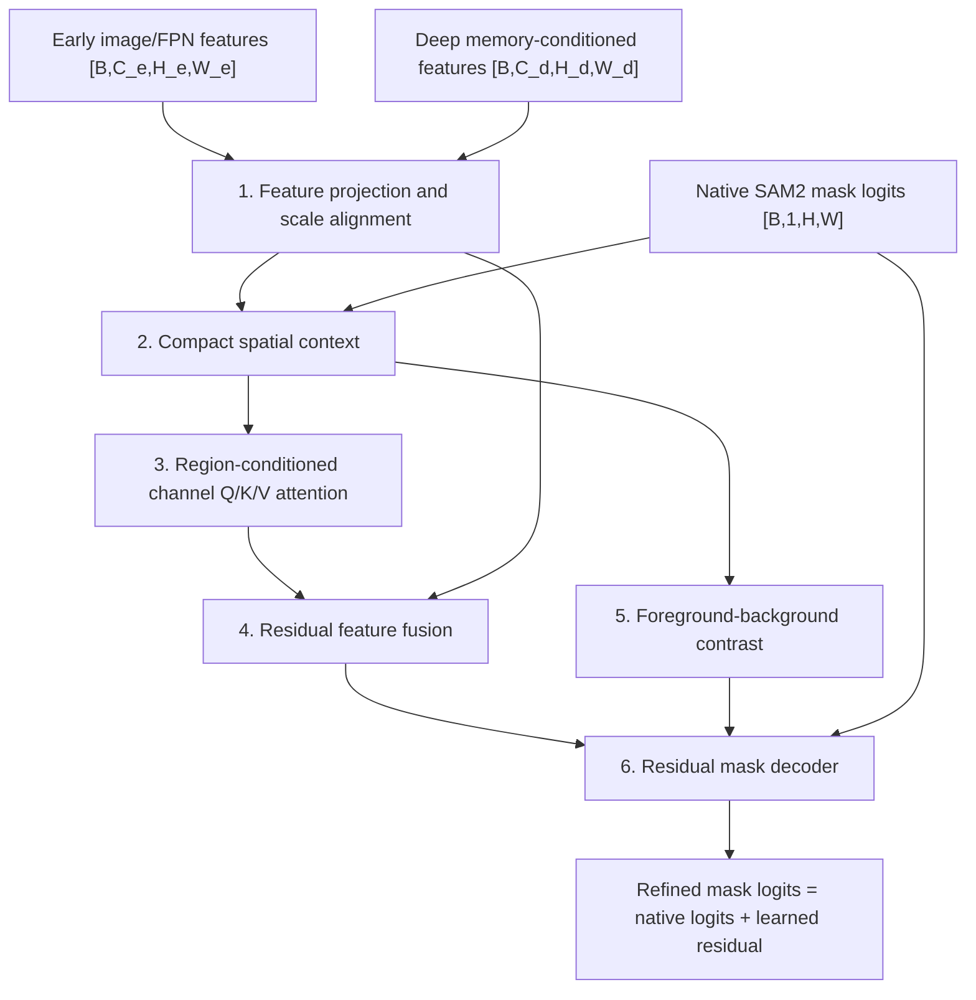

# Contribution 2 — Lean-SAM2 six-block channel-value architecture

This is the second distinct research contribution. The primary MedSAM2 method is described in [the medical high-resolution architecture](MEDICAL_HIGHRES_ARCHITECTURE.md). The Lean learned method is a **structured implementation** of the original
`MultiscaleChannelValueRefinerV1`. Its trainable tensors and source-bound
legacy implementation remain intact for strict checkpoint compatibility.



## Blocks and their responsibilities

| Stage | Code | Calculation | Shape |
|---|---|---|---|
| 1. Feature projection | `modeling/aggregation_blocks/projection.py` | Independent 1×1 projections of early and deep features, bilinear alignment and channel concatenation | `[B,C,H,W]` |
| 2. Region context | `projection.py` | Adaptive average pooling and sigmoid of **predicted** logits | `F_s:[B,C,h,w]`, `p:[B,1,h,w]` |
| 3. Channel attention | `attention.py` | Project `Q,K,V`; channel-correlation attention `A∈R^{C×C}`; mix channel values `A·V` | `[B,C,h,w]` |
| 4. Fusion | `fusion.py` | Bilinear upsample, 1×1 mixing projection, additive fine-scale residual | `[B,C,H,W]` |
| 5. Region contrast | `contrast.py` | Weighted foreground/background descriptors and cosine similarity difference | `[B,1,H,W]` |
| 6. Decoder | `fusion.py` | 3×3 Conv→GELU→1×1 Conv produces logit residual | `[B,1,H,W]` |

The parent model owns the parameters `early`, `deep`, `query`, `key`,
`value`, `mix_out` and `head`. The six stage classes are stateless on
purpose: there are **no duplicate parameters and no renamed state_dict keys**.
The standalone test `tests/test_structured_feature_aggregation.py` asserts
exact forward and gradient parity across all eight ablation modes.

### Region-aware attention

Let `F_s` be the pooled feature map and `p = sigmoid(L)` the native
foreground probability. Project `Q(F_s), K(F_s), V(F_s)`, then normalize each
channel's spatial profile after weighting it by `p` (and by `1-p` for BG).
The foreground-background mode computes

```
A = softmax[ Corr(Q · p, K · p) - Corr(Q · (1-p), K · (1-p)) ]
M = A @ V
```

The foreground and background features are inferred **only from native model
predictions**. Ground truth must never be used to construct `p` at inference.
The original implementation uses normalized spatial profiles, so the
correlation construction and mode-specific behavior are preserved exactly.

### Zero-initialized identity and teacher loss

The last 1×1 layer in `head` begins at zero:
`L_refined = L_native + ResidualHead(...)`. At initialization this is a
no-op; it does **not** guarantee baseline preservation after training.
Optional `teacher_preservation.py` objectives affect training only.

## Source/checkpoint policy

`StructuredMultistageFeatureAggregator` inherits the legacy class
`MultiscaleChannelValueRefinerV1` and has **exactly the same registered
weight keys**. The parent method `load_trained_state` still verifies the
original `multiscale_channel_value_refiner_v1.py` source hash, backbone hash,
feature-pipeline hash, manifest hash and mode. A structured checkpoint is
not permitted to bypass these checks.

**Do not conflate this learned model with either pretrained backbone.** The
audited 0.7421 method is compatibility-corrected Lean-SAM2 Hiera-B+, without
the learned aggregator. The MedSAM2-latest adapter experiments use a separate
Hiera-T/512 backbone and require new checkpoint-specific feature extraction and
new evaluation. See `docs/CHECKPOINT_PROVENANCE.md`.
